<link rel="stylesheet" href="motion.css">

<!-- _paginate: false -->
<!-- _class: title field-cover -->
<!-- _footer: "" -->

Techorama 2026 / Medieval Edition

# The Well-Architected Architect

Building secure, reliable, and cost-efficient solutions on Azure.

Chris Ayers · Microsoft

<!-- Conference opener. The original blueprint title slide follows unchanged. -->

---

<!-- _paginate: false -->
<!-- _class: title field-cover -->
<!-- _footer: "" -->

An architect's field guide

# The Well-Architected Architect

Make the tradeoff. Keep the promise. Bring the evidence.

Chris Ayers · Microsoft Principal Software Engineer / Azure EngOps AzRel

Modernizing cloud excellence

<!--
The five pillars are lenses for decisions, not five independent scores to maximize.
This first refresh introduces a retail checkout workload in the WAF section and
uses it again for the reliability sequence and the retail discussion.
-->

---

## Chris Ayers

_Principal Software Engineer_
_Azure EngOps AzRel_
_Microsoft_

<i class="fa-brands fa-bluesky"></i> BlueSky: [@chris-ayers.com](https://bsky.app/profile/chris-ayers.com)  
<i class="fa-brands fa-linkedin"></i> LinkedIn: [chris\-l\-ayers](https://linkedin.com/in/chris-l-ayers/) 
<i class="fa fa-window-maximize"></i> Blog: [https://chris-ayers\.com/](https://chris-ayers.com/)  
<i class="fa-brands fa-github"></i> GitHub: [Codebytes](https://github.com/codebytes)  
<i class="fa-brands fa-mastodon"></i> Mastodon: [@Chrisayers@hachyderm.io](https://hachyderm.io/@Chrisayers)

<!-- Legacy contact: Twitter https://twitter.com/Chris_L_Ayers.
Keep the retired, struck-through link off the projected slide. -->

---

<!-- header: 'Part 1 / Architecture fundamentals' -->

<!-- _class: lead pillar-entry part-entry -->
<!-- _header: "" -->

# Architecture fundamentals

<b>Part 1 / Architecture fundamentals</b>Part 2 / Azure Well-Architected Framework

> How do we turn a business need into a defensible decision?

**Strategic:** choose deliberately. **Operational:** make it supportable. **Collaborative:** help the team succeed.

<!-- Introduce the architect's toolkit before applying WAF. The following
roadmap names the habits; the supporting slides follow those same three groups. -->

---

# Solution Architecture Fundamentals

## How we make and validate decisions

### Strategic

Start with business needs. Make deliberate decisions. Reuse patterns. Anticipate change.

### Operational

Design for support. Keep learning.

### Collaborative

Help the team succeed. Use a repeatable method.

<!--
Start with business requirements, then apply a decision framework, design patterns,
forward thinking, supportability, continuous learning, collaboration, and a
methodical approach. These are grouped here as strategic, operational, and
collaborative habits rather than a numbered checklist.
Architecture is a team sport played with strategic thinking.
-->

---

# Architecture is a decision system

<!-- header: 'Part 1 / Architecture fundamentals / Strategic' -->

A **workload** is the application, data, and supporting services that deliver a business outcome.

- **Architecture Decision Record (ADR):** the choice, alternatives, and why.
- **Proof of concept:** a small experiment to test a risky assumption.
- **Design specification:** how the workload meets the business need.

<!--
Source: https://learn.microsoft.com/en-us/azure/well-architected/architect-role/fundamentals
Include recovery, security, and compliance in the design rather than retrofitting.
A workload can include AI models. Bring build, run, secure, and recover perspectives.
Maintain an ADR log for architecturally significant choices, including rejected
options. A proof of concept is often abbreviated PoC; a key performance indicator
(KPI) is a measure of progress toward a business objective.
-->

---

# Start with business needs

**Listen → probe → clarify → evaluate → recommend.**

- Ask why the outcome matters.
- Turn assumptions into measurable requirements.
- Compare options, then test the riskiest one.

<!--
Capture stakeholder requests and their assumptions; probe the real motivation.
Clarify requirements per flow. Evaluate feasibility, constraints, and cross-pillar
tradeoffs. Recommend with rationale, proof-of-concept results, and business
measures ready for an ADR. Repeat discovery after a major change in direction.
The next two slides make requirements concrete with service and recovery targets.
-->

---

# Define the promise before the design

<!-- _class: field -->

SLI / indicator
Service-level indicator: what we measure. Example: the share of successful checkouts.

SLO / objective
Service-level objective: the target. Example: 99.9% successful checkouts over 30 days.

Error budget
The permitted shortfall from that target. Here: 0.1% of eligible checkouts may fail.

Agree the flow, measurement window, and what counts as success.

<!--
These numbers are illustrative, not WAF defaults. A request-based availability
budget counts failed eligible requests; do not convert it directly into downtime.
An SLO is an internal target, not automatically a contractual service-level agreement.
Source: https://learn.microsoft.com/en-us/azure/well-architected/reliability/metrics
-->

---

# Define the recovery limits

<!-- _class: field -->

<svg viewBox="0 0 1120 310" role="img" aria-labelledby="recovery-title recovery-desc">
<title id="recovery-title">Recovery looks backward for data and forward for service</title>
<desc id="recovery-desc">From the outage, RPO bounds the acceptable data-loss window back to recoverable data. RTO bounds the time forward to restored service. Five and thirty minutes are independent illustrative limits.</desc>
<path class="visual-rail" d="M80 140 H1040"/>
<path class="visual-guide" d="M144 78 V120 M560 78 V120 M560 190 V245 M976 190 V245"/>
<path class="visual-rail" d="M560 80 H144 M560 230 H976"/>
<path class="visual-ink" pathLength="1" data-motion-ink="draw" data-motion-order="0" d="M560 80 H144"/>
<path class="visual-ink" pathLength="1" data-motion-ink="draw" data-motion-order="2" d="M560 230 H976"/>
<path class="visual-point" d="M144 80 l14 -7 v14 Z M976 230 l-14 -7 v14 Z"/>
<circle class="visual-point" cx="144" cy="140" r="7"/>
<circle class="visual-warning" cx="560" cy="140" r="10"/>
<circle class="visual-success" cx="976" cy="140" r="7"/>
<text class="visual-label" x="352" y="40" text-anchor="middle">RPO / at most 5 minutes</text>
<text x="144" y="180" text-anchor="middle">Recoverable point</text>
<text x="560" y="180" text-anchor="middle">Outage</text>
<text x="976" y="180" text-anchor="middle">Flow restored</text>
<text class="visual-label" x="768" y="280" text-anchor="middle">RTO / at most 30 minutes</text>
</svg>

<strong>Recovery point objective (RPO):</strong> Maximum acceptable data-loss window.

<strong>Recovery time objective (RTO):</strong> Maximum acceptable time to restore the flow.

Illustrative limits, not to scale—not WAF defaults. Drills test the business targets.

<!--
Examples are hypothetical and separate: a 30-minute RTO does not imply a
5-minute RPO, and neither follows from the 99.9% SLO on the preceding slide.
Disaster recovery (DR) restores service after a major disruption.
Source: https://learn.microsoft.com/en-us/azure/well-architected/reliability/disaster-recovery
The native SVG uses blueprint dimension lines. Entering the slide traces the
backward data-loss bound, then the forward recovery bound; the full timeline is
always visible. Revisit the slide to replay. Presenter previews remain static.
-->

---

# Make decisions deliberately

<!-- _class: field diagram -->

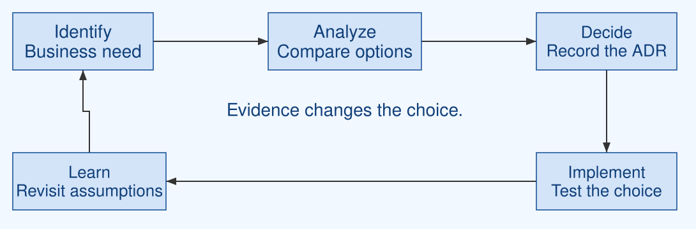

<strong>Two-way door:</strong> easy to reverse. Start with a small experiment.

<strong>One-way door:</strong> costly to reverse. Review the consequences early.

<!-- The decision framework is HOW; business alignment is WHY. Apply the
requirements established earlier, then capture the chosen tradeoff in an ADR.
Record the decision and alternatives; revisit the ADR when evidence changes. -->

---

# Reuse patterns. Anticipate change.

## Patterns

**Circuit breaker:** stop calling a failing dependency temporarily.

Choose a pattern because it solves a known problem.

## Forward Scan

Watch for growth, regulatory changes, and retiring dependencies.

Prefer a design the team can explain and operate.

<!--
Other patterns: cache-aside, bulkhead, valet key, claim-check, event-driven designs.
Specialist workloads may need high-performance computing or AI inference with
retrieval-augmented generation (RAG: retrieve relevant content before generation).
Watch data residency, preview risk, model retraining, and model drift.
Source: https://learn.microsoft.com/en-us/azure/architecture/patterns/
-->

---

# Define the failure boundary

<!-- _class: field diagram -->

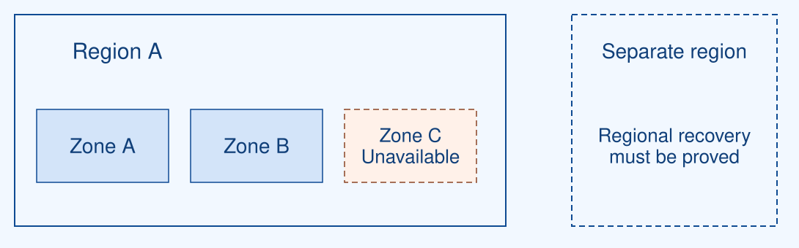

<strong>Region:</strong> a geographic deployment area containing datacenters.

<strong>Availability zone:</strong> a separate datacenter group with independent power, cooling, and networking.

Zone resilience is not regional disaster recovery.

<!--
Azure services differ in regional and zonal support. Zones contain one or more
datacenters and are physically separated within a region. A region's zones are
not separate regions; regional outages and dependency failures need their own
recovery analysis. Do not assume a paired region implies automatic recovery.
Source: https://learn.microsoft.com/en-us/azure/reliability/regions-overview
Source: https://learn.microsoft.com/en-us/azure/reliability/availability-zones-overview
-->

---

# Record the tradeoff before the incident

<!-- _class: field -->

Decision record / illustrative checkout workload

Context
Checkout must survive a zone loss at the agreed peak.

Decision
Spread capacity across zones; test capacity after failure.

Tradeoff
Extra capacity costs money before it serves traffic.

Evidence
A zone-loss drill meets the checkout SLO without new allocation.

Name the assumption. Name the owner. Name the test.

<!--
Consolidates the second pass through the fundamentals; the first pass stays
in the preceding slides. An ADR also records status, alternatives, rejected options,
reversibility, ownership, and when to revisit the choice. Capture it before code,
assess one-way versus two-way doors, and review it after implementation.
The previous healthcare ADR assumed 99.99% availability implied active-active
across three regions and a 3x infrastructure bill. Neither follows universally;
the replacement is an explicit, testable example rather than a default topology.

Supporting pattern catalog: circuit breaker, bulkhead, retry with backoff,
cache-aside, CQRS, event sourcing, valet key, gatekeeper, federated identity,
event-driven systems, service mesh, and edge computing. These solve different
problems; select against requirements rather than adopting a catalog.
Source: https://learn.microsoft.com/en-us/azure/architecture/patterns/

Forward scan: growth thresholds, regional expansion, compliance, preview risk,
fallbacks, single points of failure, coupling, and deprecations. The previous
Netflix migration claim was unsourced and is not retained as a factual example.
-->

---

<!-- header: 'Part 1 / Architecture fundamentals / Operational' -->
<!-- _class: field diagram -->

# Design for support. Keep learning.

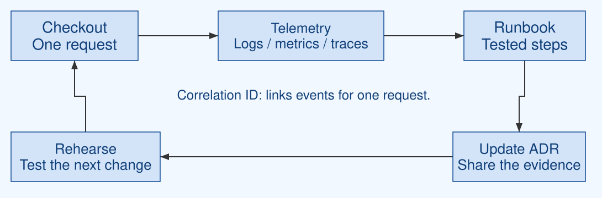

<strong>Telemetry</strong> shows system behavior. A <strong>runbook</strong> gives tested operational steps.

Review with the owner. Change the design, not just the dashboard.

<!--
This supports both Operational roadmap bullets: design for support and keep learning.
The former growth loop was Learn → apply → codify.
Golden signals track latency, traffic, errors, and saturation. Synthetic tests
simulate user journeys. Use consistent telemetry schemas and clear error contracts.
External specialists can expose assumptions the workload team has missed.
Instrument the checkout SLO, run a timed recovery drill, and compare the result
with RTO and RPO. Use a proof of concept for uncertain behavior before adoption.
Telemetry comprises logs, metrics, and traces. A correlation ID is a shared
identifier linking events for one request. A runbook provides tested steps for
an operational task or incident. Test risky assumptions, review incidents with
the owner, share the results, and update the ADR and runbook.
-->

---

<!-- header: 'Part 1 / Architecture fundamentals / Collaborative' -->

# Help the team succeed

<!-- _class: field -->

## Review together

Product, engineering, security, operations, and data share the decision.

## Make ownership clear

Name who decides, who operates it, and who reviews the evidence.

## Share the evidence

Bring experiment and drill results—not just a preferred diagram.

## Codify what worked

Update the ADR, runbook, and shared patterns.

Leave the team able to explain, operate, and revisit the decision.

<!--
The shared learning loop is Learn → apply → measure → share.
Supporting detail from the consolidated fundamentals:
Instrument, collect, analyze, visualize. Use structured logs and tiered retention;
connect hot/warm/cold analysis to health and business KPIs. DLQs, graceful
degradation, clear error contracts, runbook automation, and ChatOps support recovery.
Measure MTTR against your own baseline; the former ~75% improvement claim had no
specific supporting source and is not presented as an expected outcome.

Continuous development: role-relevant Microsoft Learn paths, FinOps/MLOps,
architecture katas, open source, hackathons, AI-assisted reviews/documentation,
meetups, architecture forums, and conference participation. Choose current
certification paths rather than treating a dated exam list as enduring guidance.
External collaborators include cloud solution architects, partner specialists,
and community experts. Useful shared artifacts: design reviews, failure scenarios,
cost workshops, and a pattern/ADR library.
Tools can include Visio/draw.io/Lucidchart/C4, wiki/Backstage, WAF Review/Advisor,
and chaos/load testing. The method and evidence matter more than the tool brand.
-->

---

# Use a repeatable method

<!-- _class: field -->

## Shared toolkit

- Agreed requirements, an owner, and an acceptance test
- ADR catalog and pattern library
- Evidence of change: target breaches, cost shifts, and configuration drift

## Working loop

Clarify → compare → decide → test → review.

Next: apply this method with the Azure Well-Architected Framework.

<!--
This supports the second Collaborative roadmap bullet: use a repeatable method.
Each step leaves an artifact another team member can inspect: requirements,
alternatives, an ADR, test results, and the next review trigger.
The former improvement loop was Assess → Prioritize → Implement → Validate →
Instrument → Reassess. Preserve measurement throughout, not only after validation.
Pillar-specific checklists and maturity baselines belong to the WAF application
that follows. This working loop is the talk's method, not an official WAF sequence.
-->

---

<!-- header: 'Part 2 / Azure Well-Architected Framework' -->

# Azure Well-Architected Framework

<!-- _class: lead pillar-entry part-entry -->
<!-- _header: "" -->

Part 1 / Architecture fundamentals<b>Part 2 / Azure Well-Architected Framework</b>

> Does the workload keep its promise across all five pillars?

Apply the fundamentals. Evaluate the tradeoffs. Bring the evidence.

<!-- This is the boundary between the architect's general toolkit and its
application through Azure WAF. The five-pillar map follows on the next slide. -->

---

# Five pillars. One workload.

<!-- _class: field pillar-map -->

Apply the architect's toolkit

<svg viewBox="0 0 1120 340" role="img" aria-labelledby="lenses-title lenses-desc">
<title id="lenses-title">Five pillars examine one workload</title>
<desc id="lenses-desc">Reliability, Security, Cost Optimization, Operational Excellence, and Performance Efficiency are connected to the same checkout workload. The spokes are evaluation lenses, not dependencies or rankings.</desc>
<path class="visual-rail" d="M500 115 L335 70 H200 M620 115 L785 70 H920 M494 175 L340 240 H170 M626 175 L780 240 H950 M560 223 V285"/>
<path class="visual-ink" pathLength="1" data-motion-ink="draw" data-motion-order="0" d="M500 115 L335 70 H200"/>
<path class="visual-ink" pathLength="1" data-motion-ink="draw" data-motion-order="1" d="M620 115 L785 70 H920"/>
<path class="visual-ink" pathLength="1" data-motion-ink="draw" data-motion-order="2" d="M494 175 L340 240 H170"/>
<path class="visual-ink" pathLength="1" data-motion-ink="draw" data-motion-order="3" d="M560 223 V285"/>
<path class="visual-ink" pathLength="1" data-motion-ink="draw" data-motion-order="4" d="M626 175 L780 240 H950"/>
<circle class="visual-node" cx="560" cy="155" r="70"/>
<circle class="visual-guide" cx="560" cy="155" r="82"/>
<text class="visual-label" x="560" y="150" text-anchor="middle">Checkout</text>
<text class="visual-detail" x="560" y="181" text-anchor="middle">One workload</text>
<circle class="visual-point" cx="200" cy="70" r="5"/><circle class="visual-point" cx="920" cy="70" r="5"/>
<circle class="visual-point" cx="170" cy="240" r="5"/><circle class="visual-point" cx="950" cy="240" r="5"/><circle class="visual-point" cx="560" cy="285" r="5"/>
<text class="visual-label" x="200" y="42" text-anchor="middle">Reliability</text>
<text class="visual-label" x="920" y="42" text-anchor="middle">Security</text>
<text class="visual-label" x="170" y="284" text-anchor="middle">Cost Optimization</text>
<text class="visual-label" x="560" y="326" text-anchor="middle">Operational Excellence</text>
<text class="visual-label" x="950" y="284" text-anchor="middle">Performance</text>
<text class="visual-label" x="950" y="318" text-anchor="middle">Efficiency</text>
</svg>

Not five scores to maximize. Five lenses for the same decision.

<!--
Sources: https://learn.microsoft.com/en-us/azure/well-architected/
https://learn.microsoft.com/en-us/azure/well-architected/what-is-well-architected-framework
The original five-pillar illustration remains at img/waf.png as a reference asset.
The pillar names are the framework's; the following intent summaries are this talk's.
Reliability: stay available and recover within targets. Security: verify access
and limit the impact of a breach. Cost: know unit cost and spend intentionally.
Operations: observe, automate, learn. Performance: test the slowest requests and scale.
The native hub makes the shared workload explicit. Slide entry traces the five
lenses once, without hiding labels or implying that one pillar is optional.
-->

---

# Start with the checkout promise.

<!-- _class: field -->

<svg viewBox="0 0 1120 360" role="img" aria-labelledby="checkout-title checkout-desc">
<title id="checkout-title">Follow the request; keep the order durable</title>
<desc id="checkout-desc">A customer reaches the edge and checkout service. Persist required order state before acknowledgement. Deferred work is relayed to a queue after the durable write; the relay and duplicate handling need a tested consistency mechanism.</desc>
<path class="visual-rail" d="M142 180 H260 M350 180 H440 M650 180 H735 Q750 180 750 165 V85 Q750 70 765 70 H825"/>
<path class="visual-guide" d="M915 115 V260"/>
<path class="visual-ink" pathLength="1" data-motion-ink="draw" data-motion-order="0" d="M142 180 H260"/>
<path class="visual-ink" pathLength="1" data-motion-ink="draw" data-motion-order="1" d="M350 180 H440"/>
<path class="visual-ink" pathLength="1" data-motion-ink="draw" data-motion-order="2" d="M650 180 H735 Q750 180 750 165 V85 Q750 70 765 70 H825"/>
<path class="visual-ink" pathLength="1" data-motion-ink="draw" data-motion-order="3" d="M915 115 V260"/>
<circle class="visual-node" cx="100" cy="180" r="42"/>
<circle class="visual-rail" cx="100" cy="167" r="11"/>
<path class="visual-rail" d="M78 200 Q78 182 100 182 Q122 182 122 200"/>
<circle class="visual-node" cx="305" cy="180" r="45"/>
<path class="visual-rail" d="M280 180 H330 M305 155 V205 M280 180 l8 -6 M280 180 l8 6 M330 180 l-8 -6 M330 180 l-8 6"/>
<rect class="visual-node" x="440" y="140" width="210" height="80" rx="4"/>
<text class="visual-label" x="545" y="173" text-anchor="middle">Checkout</text>
<text class="visual-detail" x="545" y="203" text-anchor="middle">Accept the order</text>
<path class="visual-node" d="M825 42 C825 20 1005 20 1005 42 V98 C1005 120 825 120 825 98 Z"/>
<path class="visual-rail" d="M825 42 C825 64 1005 64 1005 42"/>
<text x="915" y="82" text-anchor="middle">Order data</text>
<text class="visual-detail" x="915" y="106" text-anchor="middle">Persist first</text>
<rect class="visual-node" x="825" y="260" width="180" height="74" rx="4"/>
<text x="915" y="289" text-anchor="middle">Queue</text>
<text class="visual-detail" x="915" y="319" text-anchor="middle">Process later</text>
<text class="visual-label" x="100" y="266" text-anchor="middle">Customers</text>
<text class="visual-label" x="305" y="266" text-anchor="middle">Edge router</text>
</svg>

Complete checkout at the agreed peak—even through a tested failure.

Conceptual workload. Agree success rate, recovery targets, and cost per completed order.

<!--
This is a conceptual workload, not a deployable Azure reference architecture.
The queue represents asynchronous post-order processing, not permission to
acknowledge an order before its required durable state exists.
Define duplicate handling, payment consistency, dependency behavior, security,
data protection, and business SLOs before selecting services or a DR topology.
Later slides isolate compute capacity; a healthy API does not prove healthy data.
API means application programming interface: how software calls another service.
The edge router directs incoming requests; the queue holds work for later processing.
Measure tail latency (the slower requests), not just the average.
Slide entry draws the request path, persistence, and deferred-work relationship
in order. This is attention guidance, not a measured latency simulation.
The database-to-queue line abstracts a relay of durable work intent; it is not
a claim that writing to two services is atomic. See the later checkout redesign.
-->

---

# Use WAF to evaluate the workload

The **Azure Well-Architected Framework (WAF)** guides decisions across the five pillars.

- Start with business outcomes.
- Expose tradeoffs before choosing services.
- Test whether the workload delivers the promise.

<!--
Framework goals include resilience, proactive security, cost efficiency,
innovation, operational excellence, and predictable performance.
The framework guides decisions; using it does not guarantee an outcome.
-->

---

# Measure outcomes, not adoption.

<!-- _class: field -->

Reliability
Can customers complete checkout through a tested failure?

Value
What did the cost per completed order do after the change?

Delivery
Can we release and recover without breaking the promise?

Baseline → change → measure. Use your workload's evidence.

<!--
The former slide listed 304% ROI (Forrester TEI, Microsoft-commissioned),
40% less downtime (Global Retailer), 25% cost savings (Financial Services),
75% faster server updates (Manufacturing), and a 93/100 security score (Profisee).
It did not identify the study URL, case-study URLs, dates, populations, or
measurement methods. These figures are retained here for source follow-up, not
presented as verified outcomes or promises for the audience's workload.
-->

---

# WAF: weigh the pillar tradeoffs

| Pillar | Example tension |
|--------|-----------------|
| Reliability | Recovery readiness costs money |
| Security | Inspection adds processing time |
| Cost Optimization | Less spare capacity can weaken recovery |
| Operational Excellence | Approval controls can slow delivery |
| Performance Efficiency | Faster responses can require more resources |

<!--
Each pillar has a tradeoffs page on Microsoft Learn. Evaluate the same workload
across all five; reliability can expand attack surface, security affects
operability, and tooling has a cost. Assessment is ongoing, not a one-time audit.
-->

---

# Reliability Pillar

<!-- _class: lead pillar-entry -->

<b>Reliability</b>SecurityCost OptimizationOperational ExcellencePerformance Efficiency

> "Will it stay up & recover — for the flows that actually matter?"

**Resilient:** withstand faults. **Recoverable:** restore within RTO and RPO. **Available:** deliver the promised service.

---

# Reliability - Principles

- Set SLO, RTO, and RPO for each critical flow.
- **Failure mode analysis:** identify how the flow can fail and what happens next.
- **Graceful degradation:** keep essential functions when optional ones fail.

<!--
Assess user and system flows before redundancy spending. Failure mode analysis
is abbreviated FMA. Distinguish failures requiring intervention from expected
errors. Analyze read and write failures separately: their impacts and recovery
paths differ. Engineer reliability across code, infrastructure, and operations.
-->

---

# Reliability - Practices (Engineering)

<!-- _class: field diagram -->

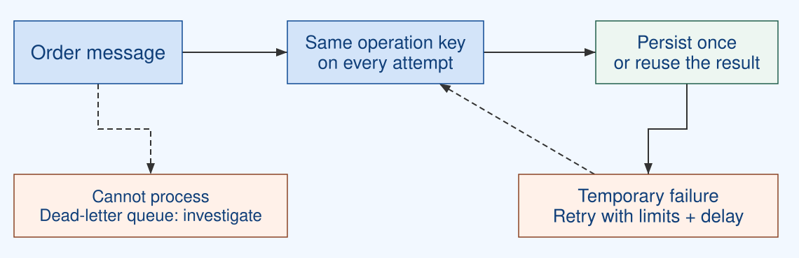

<strong>Idempotency:</strong> repeating an operation does not repeat its effect.

Design and test the failure path—not just the happy path.

<!--
Choose zonal or regional redundancy against failure modes and recovery targets,
not as an automatic tier rule. Long-running work can need checkpoints.
Service Bus PeekLock and duplicate detection support message handling, but do
not alone guarantee end-to-end idempotency. Separate read/write recovery;
secondary Blob reads are not write failover. Use supported client-library
transient-fault handling, and isolate connection pools to prevent cascading failures.
Fault injection tests graceful degradation as well as availability.
Bounded retries have limits and delays. A dead-letter queue holds unprocessable
messages for investigation; it is not automatic recovery. Isolate dependencies
and test their failures. A stable key alone does not provide idempotency:
atomically enforce it with the effect, and handle duplicates at every boundary.
-->

---

# Reliability - Practices (Operations)

If you haven't run the runbook, you haven't proved it.

- **Synthetic test:** simulate a real checkout journey.
- Time a backup restore in an isolated environment.
- Rehearse **failover:** switch traffic to a healthy recovery target.
- Name the person and conditions that activate recovery.

<!--
Feed probes and synthetic journeys into a flow-level health model. Schedule
end-to-end runbook and restore exercises at a risk-appropriate cadence; quarterly
was the original example, not a universal requirement. Automate failover validation
in delivery pipelines. Turn Azure Advisor findings into owned backlog actions.
Scheduled fault injection and anomaly detection can inform bounded recovery automation.
-->

---

# Reliability - Key Metrics

| Measure | What it tells us |
|---------|------------------|
| Successful checkouts vs SLO | Are we keeping the promise? |
| Error budget consumed | How much failure can we still tolerate? |
| Recovery time and data loss | Did the drill meet RTO and RPO? |

**Use agreed workload targets, not generic percentages.**

<!--
Track detection/recovery trends, timed restore success, and failure-exercise coverage.
The former 99.9% success, 20% budget burn, 99% drill success, and quarterly Tier-0
coverage figures were example targets, not Microsoft-prescribed thresholds.
MTTR is ambiguous across teams (repair, recovery, or resolution); state the exact
start/end events rather than using it without a definition.
-->

---

# Three zones. Is that enough?

<!-- _class: field capacity-story -->
<!-- _transition: fade 650ms -->

Checkout / healthy compute

Edge router<strong>Checkout traffic</strong><small>Health-based routing</small>

Zone A<strong>70%</strong><small>required capacity</small>
<i></i>
<b>Serving</b>

Zone B<strong>70%</strong><small>required capacity</small>
<i></i>
<b>Serving</b>

Zone C<strong>70%</strong><small>required capacity</small>
<i></i>
<b>Serving</b>

Data + queue<strong>Separate failure modes</strong><small>Not proved by compute health</small>

Before failure<strong>70% per zone</strong>
What happens to the same demand when one zone disappears?

Illustrative model: equal zones, unchanged demand, linear sharing; compute only.

<!--
Advance once after asking the room to predict the surviving load.
Each slide is a complete state. Stable view-transition names let Marp morph
the same cards without a custom runtime, timers, or hidden essential content.
Three zones each have capacity C; total demand is 3 x 0.70C = 2.10C.
This isolates stateless compute with evenly distributed, linearly scalable work.
It does not model data replication, queue semantics, retries, routing delay,
payment consistency, or other dependencies; those require their own tests.
The former architecture image remains at img/resilient.png. Its regional standby,
geo-replicated data, and DLQ ideas apply only to the failure modes they address;
a paired region or redundant compute alone is not a complete recovery design.
Source: https://learn.microsoft.com/en-us/azure/well-architected/design-guides/capacity-resilience
-->

---

# Redundancy is not surviving capacity.

<!-- _class: field capacity-story -->
<!-- _transition: fade 650ms -->

Checkout / one zone lost

Edge router<strong>Same demand</strong><small>Two surviving targets</small>

Zone A<strong>105%</strong><small>required capacity</small>
<i></i>
<b>Over capacity</b>

Zone B<strong>105%</strong><small>required capacity</small>
<i></i>
<b>Over capacity</b>

Zone C<strong>Offline</strong><small>No serving capacity</small>
<i></i>
<b>Unavailable</b>

Data + queue<strong>Separate failure modes</strong><small>Not proved by compute health</small>

After failure<strong>70% × 3 / 2 = 105%</strong>
Required load exceeds each survivor's capacity by 5 percentage points.

Demand beyond capacity, not measured processor usage above 100%. No new allocation.

<!--
Demand remains 2.10C. Two survivors have 2C total capacity, so each would need
1.05C. Required utilization above 100% describes unmet demand, not a measured
CPU value above its physical limit. Routing away from the failed zone does not
create capacity; retries may make the problem worse and are excluded here.
Ask: can we allocate more during an incident? Quota is necessary but not a
guarantee of physical capacity. Do not make recovery depend on an untested scale-out.
Source: https://learn.microsoft.com/en-us/azure/well-architected/design-guides/capacity-resilience
-->

---

# Provision the headroom before the failure.

<!-- _class: field capacity-story -->
<!-- _transition: fade 650ms -->

Checkout / redesign, then repeat the drill

Edge router<strong>Same demand</strong><small>More capacity per zone</small>

Zone A<strong>90%</strong><small>required capacity</small>
<i></i>
<b>Within capacity</b>

Zone B<strong>90%</strong><small>required capacity</small>
<i></i>
<b>Within capacity</b>

Zone C<strong>Offline</strong><small>No serving capacity</small>
<i></i>
<b>Unavailable</b>

Data + queue<strong>Separate failure modes</strong><small>Still needs recovery tests</small>

New baseline<strong>60% × 3 / 2 = 90%</strong>
Headroom is spare capacity. Pay for it before failure; test the SLO.

Alternative design, not an instantaneous recovery. 60% is illustrative, not a WAF target.

<!--
This is a redesign and a new experiment, not the next instant of the incident.
Business demand is unchanged. Increase capacity in every zone from C to 7C/6
(about 16.7% more) BEFORE the failure, so 2.10C / (3 x 7C/6) = 60% normally
and 2.10C / (2 x 7C/6) = 90% after one zone fails.
The percentages use the new, larger per-zone capacity as the denominator.
This does not imply a proportional Azure bill or guarantee an SLO: latency,
throughput, data behavior, dependency quotas, routing, and cost must be measured.
Alternatives include bounded admission, degradation of noncritical flows, and
other deployment shapes; none removes the need to define the business promise.
Rewind to compare the designs. PDF, reduced-motion, and no-JS views retain all
labels, equations, and outcomes without relying on the transition.
Source: https://learn.microsoft.com/en-us/azure/well-architected/design-guides/capacity-resilience
-->

---

# Quota is permission. Capacity is supply.

<!-- _class: field -->

Capacity resilience / plan for the allocation, not just the limit

## Quota

How much your subscription is allowed to request.

**An approved limit is not reserved hardware.**

## Capacity

What can actually be allocated for that configuration and location.

**Scale-out can fail even with enough quota.**

Forecast early. Validate alternatives. Plan recovery capacity.

<a href="https://learn.microsoft.com/en-us/azure/well-architected/design-guides/capacity-resilience">Microsoft Learn / Capacity resilience design guide</a>

<!--
The September 2026 design guide distinguishes quota from physical supply.
Allocation constraints can be regional, zonal, SKU/family-specific, or related
to cluster placement and managed-service dependencies. Consider compatible
deployment shapes, zone/region options subject to residency and latency, and
capacity reservations where supported and justified. Reservations are not the
same as pricing commitments. Capacity planning is ongoing operational work.
-->

---

# Reliability - Maturity Progression

<!-- _class: field -->

<ol class="evidence-path">
<li><strong>Define</strong>Owned recovery targets</li>
<li><strong>Rehearse</strong>A timed restore meets them</li>
<li><strong>Repeat</strong>Regular failure exercises</li>
<li><strong>Automate</strong>Proven, monitored recovery</li>
<li><strong>Adapt</strong>New failures change the design</li>
</ol>

A discussion ladder—not official WAF scoring.

<!--
This talk's discussion ladder, not a certification scale. Original progression:
ad hoc manual recovery; baseline failover documentation and probes; structured
runbooks/SLOs/fault injection; proactive automated failover and shared failure
libraries; adaptive self-healing and novel-failure rehearsal. Automated pipeline
tests, restore cadence, dashboards, and anomaly triage are possible accelerators.
Remove unknowns, speed detection, then widen safe automation.
-->

<!-- Risks: L1 False recoverability; L2 Late backup corruption detection; L3 Hidden SPOF; L4 Design vs reality drift; L5 Slow novel failure detection. -->

---

# Reliability - At a Glance

<!-- _class: glance -->

## Ask

When did we last restore checkout, timed end-to-end?

## Act

Run one restore drill. Compare the result with RTO and RPO.

<!--
Supporting signals: critical-flow availability, error budget use, restore success.
Use health models, synthetic probes, replication, and backups where justified.
A tabletop can identify an unknown, but is not a substitute for a real restore.
-->

---

# Security Pillar

<!-- _class: lead pillar-entry -->

Reliability<b>Security</b>Cost OptimizationOperational ExcellencePerformance Efficiency

> "Can it be breached — and would we see it?"

**Zero Trust:** verify explicitly, grant least privilege, and assume breach.

---

# Security - Principles

- **Threat model:** map what could be attacked and how.
- **Least privilege:** grant only the access needed, for only as long as needed.
- **Segmentation:** separate trust boundaries to limit a breach's impact.

<!--
Verify human and workload identities; encrypt data in transit and at rest according
to classification. STRIDE is one threat-model method: spoofing, tampering,
repudiation, information disclosure, denial of service, elevation of privilege.
Assign each threat a control, owner, and timeline. Prefer managed identities and
time-limited elevation over embedded secrets and permanent administrator roles.
-->

---

# Security - Practices & Patterns

**Make identity controls concrete.**

- **MFA / multifactor authentication:** verify with more than one factor.
- **PIM / Privileged Identity Management:** govern privileged access.
- **JIT / just-in-time access:** activate privilege only when needed.

Rehearse detection and containment, not just prevention.

<!--
Use Conditional Access where applicable, managed identities, network segmentation,
private endpoints, web application firewalls, and denial-of-service protection.
WAF also abbreviates web application firewall; spell it out to avoid confusion
with the Well-Architected Framework. CMK means customer-managed key; choose
key ownership against explicit requirements rather than all regulated data by default.
Defender for Cloud and Sentinel support detection and response. Rehearse tabletop,
red-team (simulated attackers), and purple-team (joint attack/defense learning) drills.
-->

---

# Security - Secure Development Lifecycle

## Before release

- Scan code and dependencies.
- Keep credentials out of source and build output.

## After release

- Patch from a maintained asset inventory.
- Test that controls detect realistic abuse.

<!--
SE:02: isolated workspaces (Dev Box/Codespaces), maintained base images, security
editor tooling, credential managers, and default-deny code. SAST is static
application security testing; DAST tests a running application. Scan supply chains.
CVE means Common Vulnerabilities and Exposures, identifiers for known vulnerabilities.
For AI, address prompt injection, content safety, and model supply-chain integrity.
AI-assisted security operations need governed permissions and containment approvals.
-->

---

# Security - Key Metrics

| Measure | Question |
|---------|----------|
| Permanent privileged access | Who can still bypass normal controls? |
| Time to detect and contain | How long can an attacker operate? |
| Critical vulnerability age | Are urgent fixes arriving in time? |

**A posture score does not prove breach detection.**

<!--
Also track MFA coverage and Secure Score findings. Former >80% score, <1-hour
detection, and <14-day critical-fix thresholds were illustrative, not WAF targets.
Define detection and containment timestamps consistently. Dwell time is how long
an attacker remains present before detection/removal; specify which end event is used.
-->

---

# Security - Architecture Example

<!-- _class: field diagram -->

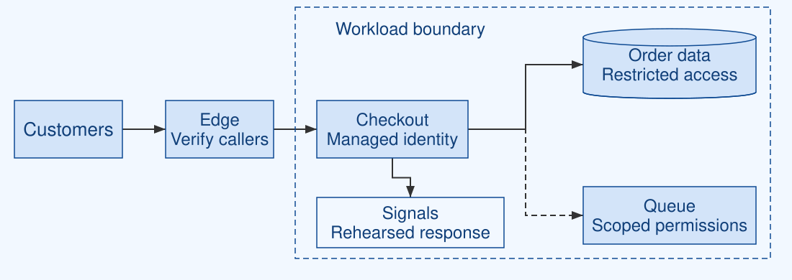

<strong>Managed identity:</strong> the service authenticates without a stored credential.

Verify each crossing. Limit access. Rehearse detection and containment.

<!--
Possible services: Front Door with a web application firewall, Application Gateway,
Entra ID, private endpoints, Key Vault, Defender for Cloud, Sentinel.
Mutual TLS authenticates both ends of a connection; apply it where required.
SIEM means security information and event management; SOAR means security
orchestration, automation, and response. Select controls for each actual flow;
do not stack products or assume Conditional Access supports every workload call.
-->

---

# Security - Maturity Progression

<!-- _class: field -->

<ol class="evidence-path">
<li><strong>Protect</strong>Identity, secrets, and patching baselines</li>
<li><strong>See</strong>Exposure and control gaps</li>
<li><strong>Rehearse</strong>Tested threats and response</li>
<li><strong>Contain</strong>Bounded attack response</li>
<li><strong>Validate</strong>Exercises expose new gaps</li>
</ol>

A discussion ladder—not official WAF scoring.

<!--
This is a discussion ladder, not a certification scale. Original accelerators:
MFA/Key Vault; Defender/private endpoints; threat models/Sentinel analytics;
automated response/risk-based access/PIM; continuous attack-defense exercises.
Detection capability matters more than a posture score alone. AI assistance
requires bounded permissions and validation, not assumed autonomous safety.
-->

<!-- 
Outcome: lower dwell time & blast radius with reduced analyst toil.
Risks if Ignored (by Level):
1: Credential stuffing / leaked keys / flat trust zones
2: Posture drift; Secure Score backlog rots
3: Slow breach containment, no IR muscle memory
4: Analyst fatigue / alert backlog / inconsistent response
5: Control regressions undetected; over-trust in aging controls
-->

---

# Security - At a Glance

<!-- _class: glance -->

## Ask

Which identities have permanent privileged access?

## Act

Replace one unnecessary permanent role with governed, time-limited access.

<!--
Other checks: secrets in pipelines, MFA and managed-identity coverage, critical
vulnerability age, detection time, key rotation. Preserve emergency access and
validate recovery before changing administrator roles.
-->

---

# Cost Optimization Pillar

<!-- _class: lead pillar-entry -->

ReliabilitySecurity<b>Cost Optimization</b>Operational ExcellencePerformance Efficiency

> "What is the unit cost — and is it trending down?"

**Unit cost:** the cost of one business outcome. For checkout: total workload cost per completed order.

<!-- Security, redundancy, and AI costs all belong in the workload cost model.
Track spend against delivered value, not just individual resource line items. -->

---

# Cost Optimization - Principles

- Assign an owner to the spend.
- **Elasticity:** adjust resources as demand changes.
- Remove waste without breaking the checkout promise.
- Record the cost of recovery readiness in the ADR.

<!-- Use ownership tags, budgets, business measures, and anomaly reviews.
Unmeasured cost is uncontrolled cost; optimization needs an accountable owner. -->

---

# Cost Optimization - Practices & Governance

- **Rightsizing:** match resource size to measured demand.
- Schedule idle development environments to stop.
- Review storage retention and unused resources.
- Use pricing commitments only for suitable, predictable demand.

<!--
CO:04 tags/budget alerts; CO:12 scaling and schedules; CO:05 reservations/savings
plans; CO:10 interruptible Spot work and storage lifecycle; CO:03 anomaly detection;
CO:07 AI allocation; CO:09 flow-cost analysis and caching.
Original 50/80/100% alerts and quarterly rightsizing were examples. Tags such as
environment, owner, and cost center support accountability. Not all resources
support tags; apply enforcement with supported scopes and exceptions.
-->

---

# Cost Optimization - Key Metrics

<!-- _class: field -->

<strong>Cost per order</strong>=

Full workload costCompleted orders

<strong>Idle spend:</strong> paying for unused resources.

<strong>Forecast vs actual:</strong> which assumption changed?

Compare equivalent demand and service quality.

<!--
Also track ownership-tag coverage, suitable commitment coverage, and anomaly
response time. Former 95%, 5%, 70%, 24-hour, and ±10% targets were illustrative.
Quarter-over-quarter unit cost can rise legitimately for improved resilience,
security, or changed demand; lower is not always better.
-->

---

# Cost Optimization - Architecture Example

<!-- _class: field diagram -->

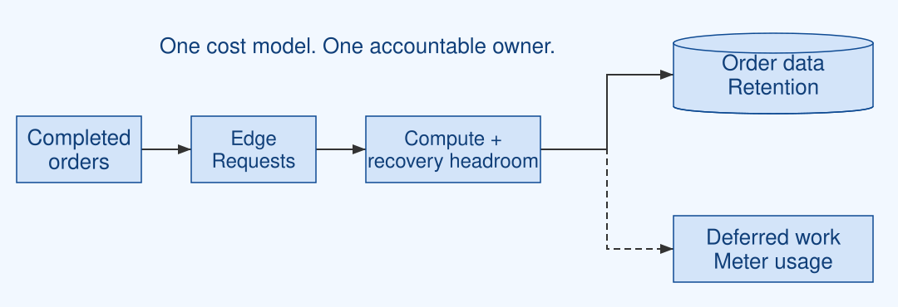

Tested recovery headroom is not automatically waste.

Compare the full bill with completed orders. Review anomalies and unused resources together.

<!--
FinOps (financial operations) brings engineering, finance, and business together
to manage technology value. Possible levers: tag policy, budget alerts, autoscale,
Spot for interruptible work, storage lifecycle, read caching, Cost Management
anomaly insights, and a monthly unit-cost review. Recovery headroom is not
automatically waste. Budget alerts do not themselves cap spending.
-->

---

# Cost Optimization Maturity Progression

<!-- _class: field -->

<ol class="evidence-path">
<li><strong>Own</strong>An owner for every spend area</li>
<li><strong>See</strong>Forecast and actual cost</li>
<li><strong>Explain</strong>Causes of waste and anomalies</li>
<li><strong>Improve</strong>Size against measured demand</li>
<li><strong>Sustain</strong>Review unit cost and quality</li>
</ol>

A discussion ladder—not official WAF scoring.

<!--
Discussion ladder, not official scoring. Original accelerators: tagging policy,
cost models and cost allocation, anomaly routing, lifecycle automation, autoscale,
forecasting, AI-assisted insights. DRI means directly responsible individual.
Former numeric thresholds were examples, not requirements for reaching a level.
-->

<!-- 

Treat cost like a performance metric: observable, owned, iterated
Cost Risks if Ignored (by Level):
1: Unattributed spend growth
2: Surprise overruns / reactive cuts
3: Persistent waste in idle flows
4: Scaling costs outpace revenue
5: Overpaying for unused resilience
Aim for unit economics clarity before advanced forecasting automation.
-->

---

# Cost Optimization - At a Glance

<!-- _class: glance -->

## Ask

What does one completed order cost, including recovery readiness?

## Act

Build one unit-cost baseline. Name the owner and one avoidable cost.

<!-- Review idle resources, tag coverage, and anomaly response. Storage lifecycle
and pricing commitments are levers, not a substitute for measuring delivered value. -->

---

# Operational Excellence Pillar

<!-- _class: lead pillar-entry -->

ReliabilitySecurityCost Optimization<b>Operational Excellence</b>Performance Efficiency

> "Can we change safely - and learn from every change?"

**Operational Excellence (OpEx):** the practices that keep delivery and operations safe, observable, and repeatable.

---

# Operational Excellence - Principles

- Share responsibility for building and running the workload.
- **Observability:** use telemetry to understand internal behavior.
- **Progressive delivery:** release to small groups, expand only while healthy.
- Learn from incidents without blame.

<!--
OE:01 shared ownership; OE:07 health models/SLOs/error budgets; OE:11 reversible
delivery; OE:02/05/10 standardization and automation; OE:08 structured response.
Infrastructure as code (IaC) declares infrastructure in version-controlled files.
Policy as code encodes enforceable rules. AI can assist routine work at any stage
but is not a mandatory maturity prerequisite.
-->

---

# Operational Excellence - Practices & Automation

<!-- _class: field diagram -->

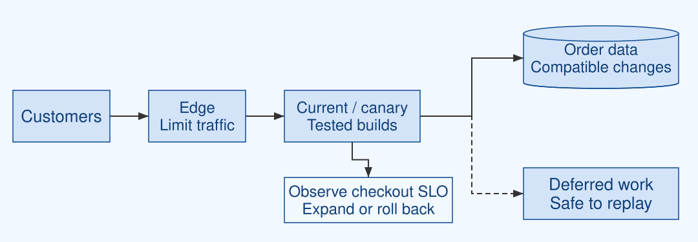

<strong>CI/CD:</strong> continuous integration and continuous delivery.

<strong>Canary release:</strong> send a small share of traffic to the new version first.

<!--
OE:06 secure supply chains: software bill of materials (SBOM), signing, scans,
immutable artifacts. OE:09 workload-specific test plans cover unit, integration,
end-to-end, load, and failure tests. OE:11 also includes blue-green releases
(switch between old/new environments) and deployment stamps (repeatable independent
deployment units), with observation time per wave. Production tests need feature
flags, scope limits, and kill switches. OE:07 instrument/collect/analyze/visualize;
OE:08 incident roles and blameless reviews close the ADR feedback loop.
-->

---

# Operational Excellence - AI Integration

**AI / artificial intelligence** can assist operational work.

Use AI to reduce toil, not bypass accountability.

- Draft tests and runbooks.
- Summarize related alerts for an operator.
- Keep remediation behind bounded permissions and approval.

<!--
The February 2026 OpEx maturity discussion includes AI assistance throughout.
Buy established assistance first; build custom generative AI only for justified
needs such as alert deduplication or risk suggestions. SRE means site reliability
engineering. Protect personally identifiable information, restrict accessible
data, and keep a human in the loop for consequential remediation.
-->

---

# Operational Excellence - Key Metrics

<!-- _class: field diagram -->

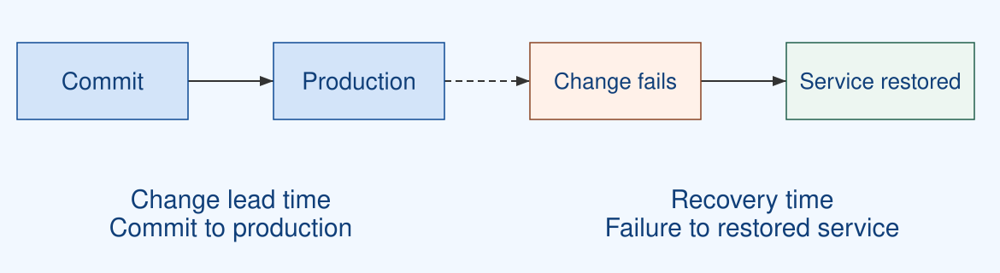

<strong>Deployment frequency:</strong> how often changes reach production.

<strong>Change failure rate:</strong> the share needing intervention.

Measure speed and safety against your own baseline. Not every deployment fails.

<!--
DORA means DevOps Research and Assessment, a delivery-performance research program.
This is a selected measurement set, not a complete current DORA taxonomy.
Former daily+, one-day, 15%, and severity-specific recovery targets were examples.
Define intervention and recovery boundaries consistently; distinguish time to
acknowledge an incident from time to restore service.
-->

---

# Release to a small cohort first.

<!-- _class: field release-story -->
<!-- _transition: fade 550ms -->

Edge router<strong>Limit exposure</strong><small>Reversible routing</small>

Current version<strong>Most requests</strong><small>Known serving path</small>

Canary version<strong>Small cohort</strong><small>New behavior under observation</small>

Health gate<strong>Observe the SLO</strong><small>Expand only while healthy</small>

What should happen when the checkout health gate fails?

Define observation time, rollback conditions, and the owner before release.

<!--
Secure builds can include dependency scans, a software bill of materials, and
signed artifacts. Progressive rings need observation time per wave. Correlation
IDs connect the telemetry pipeline. AI-assisted alert grouping and remediation
must remain governed. PR means pull request: a proposed change reviewed before merge.
The decision is Review -> build and test -> canary -> observe -> expand only
while healthy. Advance after asking the audience what to do when health worsens.
These are complete presenter-controlled states, not timed automation.
No cohort percentage is a universal recommendation.
-->

---

# Stop expansion. Restore the known path.

<!-- _class: field release-story -->
<!-- _transition: fade 550ms -->

Edge router<strong>Stop expansion</strong><small>Restore the known route</small>

Current version<strong>Serving path</strong><small>Verify recovery under load</small>

Canary version<strong>No new traffic</strong><small>Investigate the failed change</small>

Health gate failed<strong>Recheck the SLO</strong><small>Recovery is not assumed</small>

Rehearse rollback—including data compatibility—before the release.

Carry the incident evidence into tests, the runbook, and the ADR.

<!--
Rollback is conditional on compatible data, side effects, dependencies, and
capacity. Draining traffic does not undo already accepted work or database changes.
Keep durable order state and queued processing correct. Recover first, then
investigate; a fixed change needs a fresh test and canary, not automatic promotion.
The board's stable objects morph on presenter navigation; reduced motion and
PDF retain both complete states.
Source: https://learn.microsoft.com/en-us/azure/well-architected/operational-excellence/safe-deployments
-->

---

# Operational Excellence - Maturity Progression

<!-- _class: field -->

<ol class="evidence-path">
<li><strong>Foundation</strong>Ownership and version control</li>
<li><strong>Standardize</strong>Repeatable builds and roles</li>
<li><strong>Prepare</strong>Health and recovery gates</li>
<li><strong>Manage</strong>Safe releases and incident learning</li>
<li><strong>Adapt</strong>Automate and review routine work</li>
</ol>

Short labels for the WAF Operational Excellence maturity model.

<!--
Short labels summarize the WAF OpEx model: DevOps Foundation, Process
Standardization, Release Readiness, Change Management, Future Adaptability.
Original AI examples progress through task assistance, recommendations, artifact
generation, policy validation, and optimization. These are optional aids to
tested practices, not proof of maturity or a requirement to build autonomous agents.
-->

<!-- Operational Excellence Risks if Ignored (by Level):
1: Tribal ops knowledge silos
2: Inconsistent release quality
3: Alert noise & unclear severity
4: Repeating incidents / slow MTTR gains
5: Innovation slowdown / shadow ops
Reliability & velocity converge when feedback loops are automated and trusted.
Level names align with WAF OpEx maturity model (Feb 2026 update).
-->

---

# Operational Excellence - At a Glance

<!-- _class: glance -->

## Ask

Can we detect and reverse a bad checkout release?

## Act

Rehearse one rollback. Verify the health signal and the owner.

<!-- Track deployment frequency, change lead time, change failure rate, recovery,
automation success, and incident-to-ADR feedback. Telemetry without actionable
health targets cannot safely gate a release. -->

---

# Performance Efficiency Pillar

<!-- _class: lead pillar-entry -->

ReliabilitySecurityCost OptimizationOperational Excellence<b>Performance Efficiency</b>

> "Will checkout stay fast when demand rises?"

**P99 latency:** 99% of measured requests finish within this time. The slowest 1% take longer.

<!-- P50 is the median; P95 covers 95% of measured requests. Tail latency describes
the slower end of the distribution. State the flow, sample, and measurement window.
An average can conceal slow requests. -->

---

# Performance Efficiency - Principles

- Agree response-time and **throughput** targets: completed work per second.
- Test scale before the peak; quota is not capacity.
- Measure the slowest requests, not just the average.
- Change one bottleneck, then repeat the measurement.

<!-- PE:01/09 per-flow targets; PE:02 validated capacity; PE:05/08 partitioning,
caching and profiling; PE:04 baseline-driven improvement. A hot path is a
frequently executed or performance-critical path. -->

---

# Performance Efficiency - Practices & Patterns

- Test with realistic checkout demand and data.
- **Cache:** reuse a stored result instead of recalculating it.
- **Partition:** split data or work into independently handled groups.
- Block measured performance regressions before release.

<!--
PE:06 load/capacity tests; PE:05/08 data tuning; PE:09 tail latency; PE:12 gates.
Scale on queue depth, requests per second, and latency as appropriate, not CPU
alone. Possible cache layers: Front Door/content delivery network and Redis.
Choose partitioning, indexes, and scale units against the actual bottleneck;
do not partition early merely because it appears in a pattern catalog.
-->

---

# Performance Efficiency - Emerging Practices

- **Predictive scaling:** forecast demand and provision before it arrives.
- **Adaptive concurrency:** adjust how much work runs at once under pressure.
- **Throttling:** limit admitted requests to protect the service.

**First establish a repeatable baseline.**

<!--
Evaluate controls against real behavior and bounded minimum/maximum capacity.
KEDA scales on events; scaling is not itself adaptive concurrency or throttling.
AI workloads need token throughput, prompt budgets, cache behavior, and provisioned
throughput sizing. HPC needs placement-aware compute and low-latency interconnects.
Source: https://learn.microsoft.com/en-us/azure/well-architected/design-guides/throttling
-->

---

# Performance Efficiency - Key Metrics

<!-- _class: field -->

<svg viewBox="0 0 1120 330" role="img" aria-labelledby="latency-title latency-desc">
<title id="latency-title">The slowest requests disappear inside an average</title>
<desc id="latency-desc">Synthetic sample: 60 requests at 100 milliseconds, 25 at 200, 10 at 300, 4 at 600, and 1 at 1200. P95 is 300 milliseconds and P99 is 600 milliseconds. The slowest one percent takes 1200 milliseconds. These are not measurements or targets.</desc>
<path class="visual-rail" d="M30 240 H1050"/>
<rect class="visual-tail" x="645" y="175" width="390" height="150" rx="4" data-motion-ink="emphasis" data-motion-order="2"/>
<rect class="visual-bar" x="70" y="60" width="120" height="180"/>
<rect class="visual-bar" x="270" y="165" width="120" height="75"/>
<rect class="visual-bar" x="470" y="210" width="120" height="30"/>
<rect class="visual-bar" x="670" y="228" width="120" height="12"/>
<rect class="visual-warning" x="870" y="237" width="120" height="3"/>
<text x="130" y="45" text-anchor="middle">60 requests</text>
<text x="330" y="150" text-anchor="middle">25</text>
<text x="530" y="195" text-anchor="middle">10</text>
<text x="730" y="213" text-anchor="middle">4</text>
<text x="930" y="222" text-anchor="middle">1</text>
<text x="130" y="285" text-anchor="middle">100 ms</text>
<text x="330" y="285" text-anchor="middle">200 ms</text>
<text x="530" y="285" text-anchor="middle">300 ms</text>
<text x="730" y="285" text-anchor="middle">600 ms</text>
<text x="930" y="285" text-anchor="middle">1200 ms</text>
<text class="visual-label" x="530" y="320" text-anchor="middle">P95</text>
<text class="visual-label" x="730" y="320" text-anchor="middle">P99</text>
<text class="visual-detail" x="930" y="315" text-anchor="middle">Slowest 1%</text>
<path class="visual-ink" pathLength="1" data-motion-ink="draw" data-motion-order="0" d="M470 294 H590"/>
<path class="visual-ink" pathLength="1" data-motion-ink="draw" data-motion-order="1" d="M670 294 H790"/>
</svg>

P95 and P99 expose the slower requests an average can hide.

100 synthetic requests—not measurements or WAF targets. Bars show counts at each exact latency.

<!--
Former P99 ≤3×P50, >85% cache hits, and <5-minute scaling thresholds were examples,
not WAF requirements. Track performance-test results for critical flows and
AI token throughput where applicable. TTL is time to live: how long a cached
entry remains valid. Provisioned throughput units (PTUs) are a service-specific
capacity measure, not a universal AI performance target.
Other measures remain necessary: checkout throughput is completed orders per
second; cache hit ratio is the share of lookups served from the cache; scaling
response time runs from demand signal to usable capacity.
The diagram's synthetic sample contains 60 requests at 100 ms, 25 at 200 ms,
10 at 300 ms, 4 at 600 ms, and 1 at 1200 ms. Counts sum to 100.
Nearest-rank P95 is the 95th sorted request (300 ms); P99 is the 99th (600 ms).
The bars are exact categories, not equal-width numeric latency bins. Compare
real performance against the agreed load and SLO, not these illustrative values.
The native chart keeps all values visible. Slide entry underlines P95,
then P99, and brings attention to the tail; it does not animate or invent data.
-->

---

# What is checkout waiting for?

<!-- _class: field diagram performance-story -->
<!-- _transition: fade 550ms -->

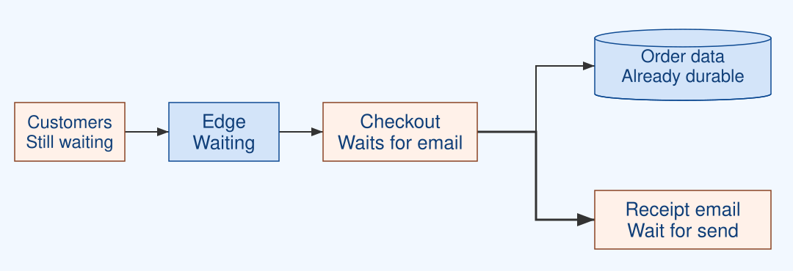

Should a receipt email delay acknowledgement of a durable order?

Illustrative critical path: work that must finish before the response.

<!-- Pause before changing the design. This illustrative baseline makes receipt
email a synchronous dependency even though the business can accept later delivery.
Agree that requirement first; do not defer work that must precede acknowledgement.
-->

---

# Move noncritical work off the path.

<!-- _class: field diagram performance-story -->
<!-- _transition: fade 550ms -->

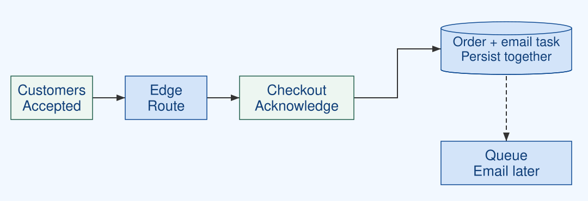

Persist required state first. Defer the email. Repeat the same load test.

A design hypothesis—not a measured speedup. Test peak load and zone loss together.

<!--
Cache safe reusable reads, move noncritical work to the queue, tune the measured
data bottleneck, and test peak load and zone loss together.
Possible implementation: Front Door edge cache, stateless application workers,
bounded background processing, Redis, partitioned data, and performance gates.
Do not cache sensitive or changing results without correct isolation/invalidation.
Queue offload is asynchronous (work completes later); required durable order
state still precedes acknowledgement. Predictive scaling is optional and needs evidence.
Persist the intent to send the email with the order, then relay it to the queue,
or use another validated consistency mechanism. A database write followed by an
uncoordinated send can lose work. Consumers need idempotency, retries, and a
recovery path. The diagram does not claim that a queue creates atomicity.
Source: https://learn.microsoft.com/en-us/azure/architecture/patterns/async-request-reply
-->

---

# Performance Efficiency Maturity Progression

<!-- _class: field -->

<ol class="evidence-path">
<li><strong>Target</strong>Agreed limits for each flow</li>
<li><strong>Baseline</strong>Repeatable load measurements</li>
<li><strong>Respond</strong>Scale on relevant demand signals</li>
<li><strong>Gate</strong>Block known regressions</li>
<li><strong>Tune</strong>Test the next bottleneck</li>
</ol>

A discussion ladder—not official WAF scoring.

<!--
Discussion ladder, not certification scoring. Original accelerators: target
worksheet, profiling, real user monitoring (RUM), load-test gates, data tuning,
predictive/adaptive controls and model-drift review.
PACELC describes distributed-data tradeoffs: during a partition, availability
versus consistency; otherwise, latency versus consistency. Keep this specialist
detail in notes unless the audience needs that specific design decision.
-->

<!-- 
Outcome: Sustained latency control & scalable performance via automated, hypothesis-driven tuning loops.
Performance Efficiency Risks if Ignored (by Level):
1: Over/under provision early tiers
2: Blind to regressions / tail spikes
3: Chasing symptoms not causes
4: Latency creep enters production
5: Plateau after easy wins
-->

---

# Performance Efficiency - At a Glance

<!-- _class: glance -->

## Ask

What is checkout's P99 response time at the agreed peak?

## Act

Run one repeatable load test. Name the slowest part of the flow.

<!-- Supporting measures: percentile response times, cache hits, scale reaction,
and AI throughput where relevant. A profiling span represents one operation
within a trace. Repeat the same load before comparing changes. -->

---

# Trade-Offs

<!-- _class: lead -->

> Every pillar pulls. Architecture is choosing **which way to lean**, on purpose.

The next slides surface the shared levers, the recurring tensions, and four scenarios where the "right" answer depends on context, not the framework.

---

# Cross-Pillar Shared Levers

| Investment | Shared benefit |
|------------|----------------|
| Health-based routing | Faster recovery and better response times |
| Least privilege | Safer access and clearer operations |
| Observability | Evidence for recovery, performance, and cost |
| Tested automation | Consistent controls and less manual work |

<!-- Autoscale and simpler architecture can help cost, performance, and reliability
when usable capacity is validated. Seek multi-pillar benefit, but do not require
every investment to advance two pillars: necessary controls may have real costs. -->

<!-- Previous bullet list version retained for reference:
Global edge + health routing; Strong identity + least privilege; Observability spine (logs, metrics, traces); Autoscale + lightweight architecture; Policy & automation as guardrails. Guiding Principle: One design decision, multi-pillar benefit. -->

---

<!-- Original trade-offs block preserved for rollback:
# Trade-Offs (empty slide)
# Key Well-Architected Framework Trade-Offs (two-column layout: Performance vs Security, Reliability vs Cost)
-- End original block -->

# Trade-Offs Overview

| Tension | Question to resolve |
|---------|---------------------|
| Reliability vs cost | What recovery readiness can we justify? |
| Security vs performance | How do required controls affect response time? |
| Delivery speed vs stability | How do we release safely and reverse failure? |
| Cost vs performance | What headroom does the tested peak need? |

<!-- Original friction signals: standby cost, inspection latency, change failures,
reactive scaling/throttling, and privilege-elevation toil. Possible responses:
criticality-based recovery, measured inspection, progressive delivery, tested
scaling, and governed just-in-time access. Surface, record, measure, recalibrate. -->

---

# <!-- fit --> Unstated trade-offs become accidental architecture

<!-- _class: lead -->

---

# Make the tradeoff testable

**Checkout example: add recovery headroom.**

| Benefit | Cost | Evidence |
|---------|------|----------|
| Survive a zone loss at peak | More provisioned capacity | A zone-loss drill meets the SLO |

What would make this decision worth revisiting?

<!--
Other original examples: regional redundancy versus cost; deeper security
inspection versus latency; underprovisioning versus reliability/performance;
oversized resources versus cost; rapid delivery versus failure risk.
Mitigations include criticality-based recovery, measured inspection, load-tested
capacity, rightsizing, secure builds, and progressive delivery.
Source: https://learn.microsoft.com/en-us/azure/well-architected/reliability/tradeoffs
-->

---

# Pillar Interactions & Decision Anchors

## Operational Excellence is the Carrier

Safe releases put improvements into production.

Observability shows whether they worked.

## Decision Anchors

Name the non-negotiable requirement.

Link the ADR to a measurable outcome.

<!-- Operational automation turns policy into repeatable behavior. Begin with
business outcomes and critical-flow SLOs; avoid treating entire pillars as
optional when prioritizing one requirement. Review decisions as evidence changes. -->

---

# Continuous Improvement & Pillar Maturity

| Level | Trait | Focus |
|-------|-------|-------|
| 1 Ad Hoc | Reactive, inconsistent | Baseline inventory & metrics |
| 2 Emerging | Initial standards | Define targets and controls |
| 3 Defined | Repeatable practice | Close feedback loops |
| 4 Managed | Measured improvement | Tune cost and performance |
| 5 Optimizing | Continuous learning | Test new assumptions |

Monthly drift scan → Quarterly deep review → Annual strategic recalibration.

<!-- A discussion cadence and ladder, not official WAF scoring or mandatory
review intervals. Adapt cadence to workload change and risk. -->

---

# Scenario-Based Trade-Off Discussions

<!-- _class: lead pillar-entry -->
<!-- _paginate: false -->

> Choose a candidate. Name the compromise. Ask what is missing.

One scenario at a time. Consequences follow your choice—not an answer key.

---

# Scenario 1: Protect patient records

<!-- _class: field scenario -->

Scenario 1 / choose an option

Protect patient data. Keep essential care working during outages.

A / Online only<h2>One live record</h2>
Require connectivity for reads and updates.

B / Read-only copy<h2>Keep reading</h2>
Protect local copies; pause offline updates.

C / Offline updates<h2>Keep working</h2>
Save changes locally; reconcile after reconnecting.

D / Limited fallback<h2>Essential care only</h2>
Use approved downtime steps; reconcile later.

What must stay available? How stale can data be?

<!--
PHI is a legal term in the US HIPAA context; use jurisdiction-specific definitions
and requirements for an actual deployment. Original audience options ranked the
pillars, preferring security/reliability before performance/cost. Replace a
universal ordering with explicit confidentiality, access, audit, retention, and
clinical availability requirements. Establish baseline controls early; no pillar
is optional. Discuss identity, encryption, logging, and recovery before tuning.
PHI means protected health information: identifiable health data subject to
applicable privacy rules. Use "patient data" on screen to avoid specialist jargon.
Pause for A/B/C/D and a reason before revealing consequences. These are access
patterns, not complete architectures; combine them only with explicit boundaries.
All options require appropriate identity, authorization, encryption, audit,
retention, and jurisdiction-specific controls. A local copy is not a backup.
The fallback must be approved by clinical and privacy stakeholders, not an
improvised bypass of access controls. Establish clinical safety and recovery
requirements before choosing a pattern.
-->

---

# Patient records: consequences

<!-- _class: field scenario -->

Scenario 1 / reveal the consequences

A / Online only
Fewer copies to govern. Connectivity loss can block care workflows.

B / Read-only copy
Reads can continue. Copies become stale and need protection and expiry.

C / Offline updates
Work can continue. Conflicting edits and lost devices become design risks.

D / Limited fallback
Less offline software to build. Manual handoffs can delay or lose information.

Rehearse safe care, access controls, and record reconciliation—not just uptime.

<!--
These are conditional tradeoffs, not a clinical recommendation. Validate what
data each role needs, acceptable staleness, copy revocation/expiry, audit capture,
device management, and conflict resolution. A downtime workflow may be paper
or a separately approved system; it still needs controlled access, secure handling,
training, and later reconciliation. Do not equate application availability with
clinical safety. Test the chosen pattern with authorized clinical stakeholders.
-->

---

# Scenario 2: Handle a retail peak

<!-- _class: field diagram scenario -->

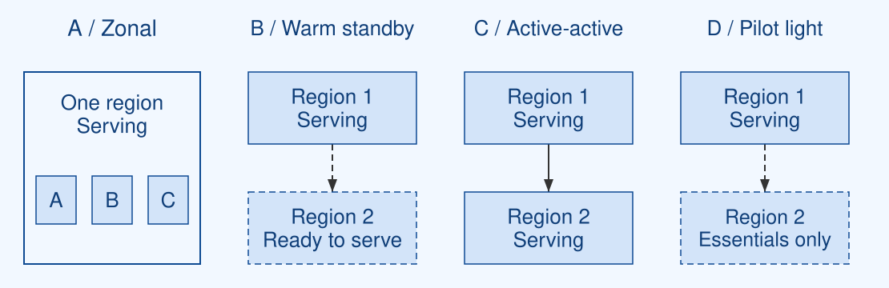

Choose a candidate—or name the missing requirement first.

10x demand forecast; limited rehearsal. Pilot light activates the rest during recovery.

<!--
Pause here. Ask the audience to choose A/B/C/D or explain what is missing.
Do not advance until they have offered a reason. The following slides contain
consequences and additional assumptions, so the reveal follows presenter navigation.
10x is an illustrative business forecast, not a measured load-test result.
Missing requirements include per-flow SLOs, RTO/RPO, data consistency, dependency
recovery, traffic geography, capacity readiness, and the team's operating capacity.
The earlier version preselected B and conflated serverless with no planning.
Serverless is a compute model, not a regional recovery topology; any option can
use it where appropriate. A 10x forecast alone cannot select a DR architecture.
Warm standby keeps a secondary ready to take over; active-active serves live
traffic in both regions. Pilot light runs essentials and activates the rest during
recovery. Lines are conceptual relationships, not a complete replication design.
Checkout continuity and cost both matter; neither dictates a topology alone.
-->

---

# Retail peak: consequences

<!-- _class: field scenario -->

Scenario 2 / reveal the consequences

A / One region
Less regional coordination. A regional outage still needs an acceptable recovery path.

B / Warm standby
Maintain recovery readiness. Prove data recovery, routing, and surviving capacity.

C / Active-active
Both regions serve. Handle consistency, dependency failures, and operational complexity.

D / Pilot light
Less running standby compute. Recovery may depend on allocation and longer activation.

Which compromise can the business actually accept?

<!--
These are qualitative tradeoffs, not cost rankings or guarantees.
Warm standby, active-active, and pilot light have different readiness and recovery
assumptions. A running secondary region does not prove failover works, and its
capacity must support the required recovery load. Active-active does not remove
the need for fault isolation, data recovery, or tests. Pilot light may need new
compute allocation during recovery, linking back to quota versus capacity.
Source: https://learn.microsoft.com/en-us/azure/well-architected/reliability/disaster-recovery
-->

---

# Warm standby is a candidate, not an answer key.

<!-- _class: field scenario -->

Retail decision / add the assumptions, then validate

## Suppose we agree

- A bounded regional recovery window is acceptable.
- The team can fund and operate a standby.

## Before accepting B

- Test RTO/RPO, data, and routing.
- Prove 10x peak and recovery capacity.

Record the tradeoff in an ADR. Change the choice if the evidence fails.

<!--
These are new hypothetical constraints for the discussion, not facts about a
customer deployment or an official WAF recommendation for all retail systems.
Suppose one primary market serves most traffic; validate dependencies as well
as data and routing during the drill.
B is a candidate under these assumptions, not automatically the lowest-cost or
best design. Start by agreeing numerical targets with stakeholders, then rehearse
the failure and recovery. A region, SKU, or data-store dependency can invalidate
the proposal. A and D remain candidates if their recovery behavior meets the
business requirements; C may fit global serving or stricter recovery needs if
the team can justify and operate its added complexity.
Load/chaos rehearsal, autoscale thresholds, error budgets, and cost evidence
inform the decision. Do not deploy predictive controls merely because demand
is forecast to increase; establish a repeatable baseline first.
-->

---

# Scenario 3: Modernize a nightly batch

<!-- _class: field scenario -->

Scenario 3 / choose an option

The nightly job needs faster results. This quarter's refactor budget is limited.

A / Move unchanged<h2>Change the location</h2>
Run the same application on cloud machines.

B / Replatform<h2>Change the hosting</h2>
Keep the application; adopt managed services.

C / Targeted refactor<h2>Change the bottleneck</h2>
Rewrite only the slowest measured stage.

D / Rebuild<h2>Change the design</h2>
Replace the batch application end to end.

Which change can meet the deadline within the available budget?

<!--
Original choices: lift-and-shift virtual machines; full microservices/events;
managed-service replatforming; full rebuild with AI/machine learning.
Replatforming is a candidate when compatible and measurable, not an automatic
answer. Moving unchanged may meet immediate needs; rebuilding may be justified
by actual constraints. Assess the bottleneck, managed database/queue/scheduler
fit, migration risk, and a baseline before decomposing hotspots.
Pause for a choice before revealing consequences. Establish the completion
deadline, input size, current duration, cost per run, and recovery behavior.
Managed services reduce selected operating tasks, not all operational ownership.
-->

<!-- Facilitator Notes: Map quick wins: managed DB, queue, scheduler; carve out hotspots post replatform KPI baseline. -->

---

# Nightly batch: consequences

<!-- _class: field scenario -->

Scenario 3 / reveal the consequences

A / Move unchanged
Less code change. The same bottleneck may remain—and cost more to run.

B / Replatform
Less infrastructure upkeep. Service limits and compatibility may require changes.

C / Targeted refactor
Focused effort. A wrong diagnosis buys little; integration still needs testing.

D / Rebuild
Freedom to redesign. More delivery risk and parallel running before replacement.

Compare completion time, cost per run, and recovery using the same input.

<!--
No option guarantees a faster batch or a lower bill. Profile CPU, storage,
network, locking, and dependency waits before committing. A cloud move may be
sufficient if measured capacity meets the deadline within budget.
For managed services, test quotas, scheduling, data movement, and supported APIs.
For a refactor or rebuild, compare output correctness as well as elapsed time;
rehearse restart, duplicate processing, partial failures, rollback, and cutover.
Replatforming is a candidate when evidence supports it, not an answer key.
-->

---

# Scenario 4: Early-Stage Social App

<!-- _class: field scenario -->

Scenario 4 / choose an option

A young product needs feedback, limited spend, and essential protections.

A / Invite-only pilot<h2>Start small</h2>
Limit users and features; use managed hosting.

B / Public, one region<h2>Test wider demand</h2>
Open sign-ups; use managed hosting and usage limits.

C / Own the platform<h2>Build custom operations</h2>
Run the infrastructure yourselves.

D / Multiple regions<h2>Serve globally now</h2>
Distribute application and data from launch.

What is the smallest secure launch that tests demand?

<!-- Optimize for validated learning with baseline identity, data protection,
dependency hygiene, and observability in place. Incremental hardening does not
mean delaying essential security. B is a candidate if it meets those requirements. -->

<!-- Original options contrasted broad up-front controls, secure MVP, immediate
multi-region, and heavy automation. Choose proportionate controls based on data,
users, and obligations. Do not treat compliance or essential security as optional
because the company is early-stage. -->

<!-- Facilitator Notes: Introduce maturity runway: baseline hygiene → observability → scaling → advanced security & multi-region. -->

<!-- MVP means minimum viable product: the smallest product that tests a useful
business hypothesis. The expanded question avoids needing the acronym on screen.
Pause for a choice before revealing consequences. All options require baseline
identity, data protection, abuse prevention, dependency hygiene, and observability.
An invite-only pilot limits exposure; it does not waive security or privacy duties.
Decide audience geography, data handling, spend limits, and operating ownership.
-->

---

# Social app: consequences

<!-- _class: field scenario -->

Scenario 4 / reveal the consequences

A / Invite-only pilot
Smaller exposure and spend. Feedback may not represent the wider market.

B / Public, one region
Broader learning. Abuse and spend can grow; a regional outage affects everyone.

C / Own the platform
More infrastructure control. Patching and on-call work compete with product learning.

D / Multiple regions
Potentially better reach and resilience. Data coordination and operating costs grow.

Expand when demand, geography, or recovery needs justify the added complexity.

<!--
These choices describe launch scope and operating models, not mutually exclusive
features forever. Managed hosting still needs application security, monitoring,
incident ownership, and cost controls. Multiple regions do not automatically
provide working failover; test routing, data recovery, and dependency behavior.
Choose measurable learning goals and a reassessment trigger before launch.
Retain proportionate, required controls whichever scope is chosen.
-->

---

# Well-Architected Framework Service Guides

**A decision-making tool, not a configuration manual.**

- Review a candidate service across all five pillars.
- Identify the features that affect the workload's requirements.
- Test the assumptions before adopting the service.

<!--
Pair service guides with Azure Advisor findings and a Well-Architected Review.
March 2026 examples included SQL Managed Instance, MySQL flexible server,
Container Apps, Event Grid, Event Hubs, Service Bus, Blob, Databricks, Virtual WAN.
Consult the current guide for each service rather than treating a dated list as
an exhaustive or permanently current feature guarantee.
-->

---

# Well-Architected Workloads

A workload is bigger than its application code.

- Map data, dependencies, and supporting services.
- Name owners for the flow and shared controls.
- Keep requirements, budget, and ADRs current.

<!-- The workload record can include user/agent personas, technical debt, business
indicators, and assessment results. Balance functional behavior with quality
requirements; include AI models when they participate in the business outcome.
Clarify responsibilities between workload teams and centralized platform teams. -->

---

# Well-Architected Workloads Examples

<!-- _class: field -->

## Match the workload

AI, analytics, and mission-critical systems have specialist guidance.

**SaaS:** software as a service. **HPC:** high-performance computing.

## Apply a cross-cutting lens

Sustainability guidance works through the five pillars—not as a sixth pillar.

<!--
Examples highlighted on the current WAF hub:
https://learn.microsoft.com/en-us/azure/well-architected/
https://learn.microsoft.com/en-us/azure/well-architected/sustainability/
The preceding list also included Azure Virtual Desktop, Azure VMware Solution,
Oracle, and SAP; consult the workload index for guidance relevant to the actual
scenario rather than treating the hub's featured cards as an exhaustive catalog.
-->

---

# What To Do Monday

One concrete action per pillar — pick **one row**, land it this week, bring back evidence.

| Pillar | This week's move |
|--------|------------------|
| Reliability | Run a **timed** restore drill on your #1 critical flow |
| Security | Review one permanent privileged role |
| Cost Optimization | Baseline cost per completed order |
| Operational Excellence | Rehearse one health-gated rollback |
| Performance Efficiency | Measure checkout P99 at peak |

<!-- Supporting actions: governed PIM/JIT elevation; supported ownership tags and
idle reports; SLO/error-budget alerts delivered to the operational team;
profiling the slowest request. Protect emergency access when changing roles.
One ADR, one drill, one baseline at a time. -->

---

<!-- _paginate: false -->
<!-- _class: lead -->

# Questions & tradeoffs

Which assumption would you test first in your workload?

<!-- The original Q&A backdrop (./img/questions.jpg) is retained as an asset.
Use the shared blueprint theme here so the closing discussion stays consistent. -->

---

<!-- _class: resources -->

## Resources

- [Well-Architected Framework](https://learn.microsoft.com/en-us/azure/well-architected/)
- [What's new in the WAF](https://learn.microsoft.com/en-us/azure/well-architected/whats-new)
- [Azure Advisor](https://learn.microsoft.com/en-us/azure/advisor/advisor-overview)  
- [Azure Architecture Center](https://learn.microsoft.com/en-us/azure/architecture/browse/)
- [Well-Architected Review Assessment Tool](https://aka.ms/waf-assessment)
- [Capacity resilience design guide](https://learn.microsoft.com/en-us/azure/well-architected/design-guides/capacity-resilience)

## Chris Ayers

Microsoft

[chris-ayers.com](https://chris-ayers.com/)

[GitHub / Codebytes](https://github.com/codebytes)

[Bluesky / @chris-ayers.com](https://bsky.app/profile/chris-ayers.com)

<!--
Additional resources:
Full contact details are on the opening bio slide and in README.md.
Legacy contact: Twitter https://twitter.com/Chris_L_Ayers.
https://learn.microsoft.com/en-us/training/paths/azure-well-architected-framework/
https://learn.microsoft.com/en-us/azure/cost-management-billing/
https://learn.microsoft.com/en-us/azure/advisor/advisor-score
https://learn.microsoft.com/en-us/azure/well-architected/design-guides/throttling
https://learn.microsoft.com/en-us/azure/well-architected/design-guides/testing
https://learn.microsoft.com/en-us/azure/well-architected/design
All new visuals are authored slide states; no runtime diagram CDN is required.
-->

---

<!-- _class: lead -->
<!-- _paginate: false -->
<!-- _footer: "" -->
<!-- _header: "" -->

<!-- Invite the audience to scan the supplied SpreaView QR code and review
The Well-Architected Architect. Leave this slide visible during final feedback. -->